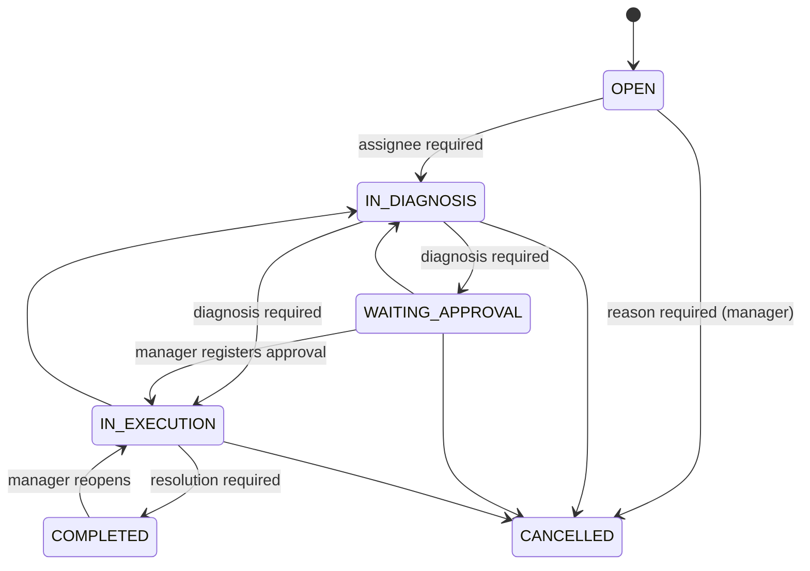

# FlowDesk

[](https://github.com/YOUR_USER/flowdesk/actions/workflows/ci.yml)


**Multi-tenant service desk and work-order platform** for maintenance, IT support and field-service companies.
Companies register, invite their team, open service orders and move them through a **validated workflow**, with a full **audit trail**, **SLA alerts**, **asynchronous notifications** and productivity **reports**.

> 🇧🇷 Leia em português: [README.pt-BR.md](README.pt-BR.md)

## Why this project

It is built to show real-world backend engineering rather than CRUD:

| Concern | How FlowDesk handles it |
|---|---|
| **Business rules** | Explicit finite-state machine; invalid jumps (e.g. `OPEN → COMPLETED`) are rejected, required data is enforced per step |
| **Multi-tenancy** | Shared schema with `company_id`; tenant always derived from the authenticated user, foreign ids answer `404` |
| **Security** | Stateless JWT, BCrypt, role-based access (Admin / Manager / Technician), principal re-checked in the DB on every request |
| **Auditability** | Append-only audit log written in the same transaction as each change |
| **Async processing** | Domain events → `@Async` + `AFTER_COMMIT` listeners for in-app + e-mail notifications |
| **Reliability** | Optimistic locking, per-company sequential numbers with row locks, idempotent SLA monitor |
| **Quality** | Unit tests for the workflow + end-to-end tests on real PostgreSQL (Testcontainers), JaCoCo, CI |
| **Operations** | Flyway migrations, Docker image, Docker Compose, health probes, OpenAPI/Swagger |

## The workflow



Every rule lives in one framework-free class ([`ServiceOrderWorkflow`](src/main/java/com/flowdesk/serviceorder/ServiceOrderWorkflow.java)) and answers with a precise HTTP status:

| Situation | Status |
|---|---|
| Transition not allowed by the state machine | `409 Conflict` |
| Role/ownership does not allow it | `403 Forbidden` |
| Missing data (diagnosis, resolution, reason, assignee) | `422 Unprocessable Entity` |
| Order from another company | `404 Not Found` |

## Roles

| Capability | Technician | Manager | Admin |
|---|:--:|:--:|:--:|
| See orders | only assigned to them | all | all |
| Create / edit / assign orders | – | ✅ | ✅ |
| Move status | only own orders (no cancel, no approval, no reopen) | ✅ | ✅ |
| Add service records and attachments | own orders | ✅ | ✅ |
| Manage customers | – | ✅ | ✅ |
| Dashboard and reports | – | ✅ | ✅ |
| Create users, activate/deactivate | – | – | ✅ |

## Features

- Companies (tenants), users with roles, customers
- Service orders with priority (Low → Urgent), assignee, `OS-000123` numbering per company
- SLA due date derived from priority (configurable) and recalculated when priority changes
- Technician **service records** (notes and minutes spent)
- **Attachments** with allow-listed types, size limit and sanitised file names
- **Audit timeline** per order (who changed what, from which value to which)
- **Notifications**: in-app and e-mail (pluggable gateway), SLA "due soon" and "breached" alerts
- **Dashboard**: orders by status/priority, overdue, completed, on-time rate, average resolution time
- **Productivity report** per technician and **CSV export**
- Filtering, search and pagination, RFC 7807 problem responses, OpenAPI docs

## Tech stack

Java 21 · Spring Boot 3.3 · Spring Web, Data JPA (Hibernate), Security, Validation, Actuator · PostgreSQL 16 · Flyway · JWT (jjwt) · springdoc-openapi · JUnit 5, MockMvc, Testcontainers · JaCoCo · Docker / Docker Compose · GitHub Actions

## Getting started

### Option 1 — Docker Compose (recommended)

```bash
cp .env.example .env
# optional: set SPRING_PROFILES_ACTIVE=demo in .env to load sample data
docker compose up --build
```

- API: http://localhost:8080
- Swagger UI: http://localhost:8080/swagger-ui.html
- Health: http://localhost:8080/actuator/health

With the `demo` profile you can log in immediately (password `Demo@12345`):

| User | Role |
|---|---|
| `admin@demo.flowdesk.dev` | Admin |
| `manager@demo.flowdesk.dev` | Manager |
| `bruno@demo.flowdesk.dev`, `carla@demo.flowdesk.dev` | Technicians |

### Option 2 — Run locally

Requirements: JDK 21, Maven 3.9+, PostgreSQL 16 (or `docker compose up db`).

```bash
mvn spring-boot:run -Dspring-boot.run.profiles=demo
```

### Tests

```bash
mvn verify          # unit + integration tests (Docker needed for Testcontainers) + coverage
```

Coverage report: `target/site/jacoco/index.html`.

## API tour

Ready-to-run requests live in [`docs/api.http`](docs/api.http). Main endpoints:

| Area | Endpoints |
|---|---|
| Auth | `POST /api/auth/register-company`, `POST /api/auth/login`, `GET /api/auth/me` |
| Users | `POST /api/users`, `GET /api/users`, `GET /api/users/technicians`, `PATCH /api/users/{id}/active` |
| Customers | `POST/PUT/GET /api/customers`, `GET /api/customers/{id}` |
| Service orders | `POST/GET /api/service-orders`, `GET/PUT /api/service-orders/{id}`, `PUT …/assignee`, `POST …/transitions`, `GET …/allowed-transitions`, `GET …/timeline` |
| Records | `POST/GET /api/service-orders/{id}/records` |
| Attachments | `POST/GET /api/service-orders/{id}/attachments`, `GET …/{attachmentId}` |
| Notifications | `GET /api/notifications`, `GET …/unread-count`, `POST …/{id}/read`, `POST …/read-all` |
| Insights | `GET /api/dashboard/summary`, `GET /api/reports/productivity`, `GET /api/reports/service-orders.csv` |

Example — an invalid jump is refused:

```http
POST /api/service-orders/{id}/transitions
{ "targetStatus": "COMPLETED", "resolution": "Done" }

409 Conflict
{ "title": "Invalid workflow transition",
  "detail": "Cannot move a service order from OPEN to COMPLETED. Allowed targets: [IN_DIAGNOSIS, CANCELLED]" }
```

## Architecture

Modular monolith organised by feature (package-by-feature); each module owns its entity, repository, service, controller and DTOs.

```
src/main/java/com/flowdesk
├── auth · user · company · customer      identity and tenants
├── serviceorder                          workflow, SLA calculator, specifications, service
├── servicerecord · attachment            technician notes and files
├── audit                                 append-only history
├── notification · sla                    async listeners and the SLA monitor
├── dashboard                             indicators, productivity report, CSV
├── security · config · common            JWT, tenancy helper, error handling
└── demo                                  optional sample data (profile "demo")
```

Key decisions are recorded as ADRs in [`docs/adr`](docs/adr):

1. [Explicit workflow state machine](docs/adr/0001-explicit-workflow-state-machine.md)
2. [Multi-tenancy with shared schema](docs/adr/0002-multi-tenancy-shared-schema.md)
3. [Append-only audit trail](docs/adr/0003-audit-trail.md)
4. [Async notifications and idempotent SLA monitor](docs/adr/0004-async-notifications-and-sla.md)
5. [Optimistic locking and per-company numbers](docs/adr/0005-optimistic-locking-and-order-numbers.md)

## Configuration

| Variable | Purpose | Default |
|---|---|---|
| `DB_URL`, `DB_USER`, `DB_PASSWORD` | PostgreSQL connection | local Postgres |
| `JWT_SECRET` | HMAC key, **≥ 32 bytes** (required in production) | dev-only value |
| `JWT_EXPIRATION_MINUTES` | Token lifetime | `60` |
| `STORAGE_PATH` | Where attachments are stored | `./data/attachments` |
| `CORS_ALLOWED_ORIGINS` | Allowed front-end origins | `localhost:3000,5173` |
| `SPRING_PROFILES_ACTIVE` | `demo` loads sample data | – |

SLA targets (hours by priority) are under `flowdesk.sla.*` in `application.yml`.

## Roadmap

- React + TypeScript front-end (Kanban board per status, order detail with timeline)
- Transactional outbox + message broker for guaranteed notification delivery
- Object storage (S3-compatible) behind the existing `FileStorage` port
- Refresh tokens and rate limiting on authentication endpoints
- PostgreSQL Row Level Security as a second tenant-isolation layer
- Per-company configurable workflows and SLA policies

## License

[MIT](LICENSE)
