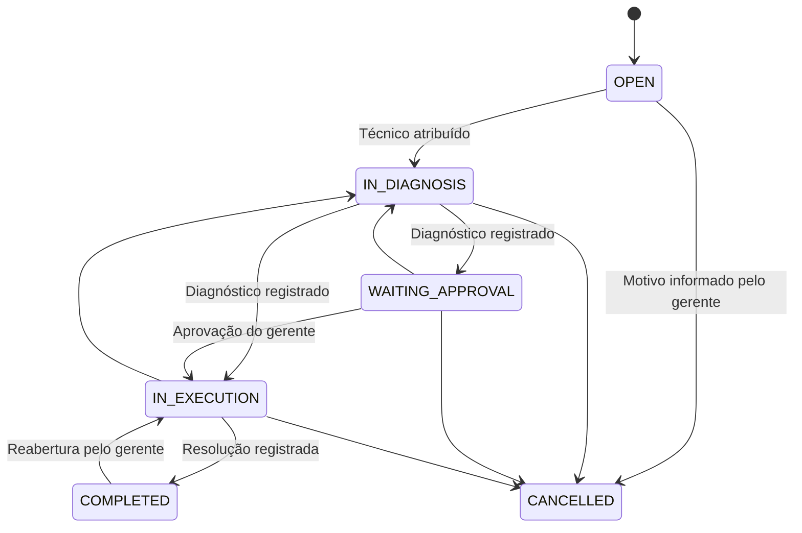

# FlowDesk

[](https://github.com/HernandesWolf/Flowdesk_26/actions/workflows/ci.yml)


**FlowDesk é uma API backend para gestão de atendimento e ordens de serviço em empresas de manutenção, assistência técnica, suporte de TI e serviços especializados.**

A plataforma foi concebida para lidar com desafios comuns de sistemas empresariais: múltiplas empresas utilizando a mesma aplicação, controle de acesso por perfil, regras de negócio, rastreabilidade de alterações, acompanhamento de prazos e geração de relatórios.

> 🇺🇸 **English version:** [README.md](README.md)

## Objetivo do projeto

O FlowDesk busca demonstrar conceitos de engenharia de software que vão além das operações básicas de CRUD (*Create, Read, Update, Delete*).

| Desafio | Abordagem adotada |
|---|---|
| **Regras de negócio** | Máquina de estados explícita para validar as transições das ordens de serviço |
| **Isolamento entre empresas** | Arquitetura multiempresa com identificação do tenant pelo usuário autenticado |
| **Segurança** | Autenticação JWT, senhas protegidas com BCrypt e autorização por perfil |
| **Rastreabilidade** | Registro de alterações em trilha de auditoria |
| **Processamento assíncrono** | Eventos de domínio e notificações processadas após a confirmação da transação |
| **Concorrência** | Bloqueio otimista e controle da numeração das ordens por empresa |
| **Qualidade** | Testes automatizados, integração com PostgreSQL por Testcontainers e relatório de cobertura com JaCoCo |
| **Operação** | Migrações com Flyway, Docker, Docker Compose e documentação OpenAPI |

## Funcionalidades

- Cadastro de empresas e usuários com diferentes níveis de acesso.
- Gerenciamento de clientes e ordens de serviço.
- Classificação de prioridades, atribuição de responsáveis e numeração individual por empresa.
- Controle de transições de estado, com validação das regras de negócio.
- Registro de diagnóstico, execução, resolução e cancelamento.
- Cálculo de prazos de atendimento (SLA) conforme a prioridade.
- Histórico de alterações para facilitar a auditoria.
- Registros de atendimento com anotações e tempo de execução.
- Anexos com validações de tipo e tamanho.
- Notificações no sistema e por e-mail, conforme a configuração.
- Painel de indicadores operacionais.
- Relatórios de produtividade por técnico e exportação CSV.
- Pesquisa, filtros e paginação.
- Respostas de erro no padrão RFC 7807.
- Documentação da API com OpenAPI/Swagger.

## Fluxo de uma ordem de serviço

O fluxo de trabalho utiliza uma máquina de estados para impedir transições incompatíveis com as regras definidas para o negócio.



As regras do fluxo estão centralizadas na classe [`ServiceOrderWorkflow`](src/main/java/com/flowdesk/serviceorder/ServiceOrderWorkflow.java).

Exemplos de respostas esperadas para situações de negócio:

| Situação | Código HTTP |
|---|---|
| Transição de estado não permitida | `409 Conflict` |
| Usuário sem autorização para a operação | `403 Forbidden` |
| Dados obrigatórios ausentes | `422 Unprocessable Entity` |
| Recurso pertencente a outra empresa | `404 Not Found` |

## Perfis de acesso

| Permissão | Técnico | Gerente | Administrador |
|---|:---:|:---:|:---:|
| Consultar ordens atribuídas | ✅ | ✅ | ✅ |
| Consultar todas as ordens da empresa | — | ✅ | ✅ |
| Criar e editar ordens | — | ✅ | ✅ |
| Atribuir responsáveis | — | ✅ | ✅ |
| Executar transições permitidas | ✅ | ✅ | ✅ |
| Gerenciar clientes | — | ✅ | ✅ |
| Consultar indicadores e relatórios | — | ✅ | ✅ |
| Criar e gerenciar usuários | — | — | ✅ |

As permissões específicas também dependem das regras de propriedade dos recursos e das transições permitidas pelo fluxo de trabalho.

## Tecnologias utilizadas

**Linguagem e framework**
- Java 21
- Spring Boot 3.3
- Spring Web
- Spring Data JPA e Hibernate
- Spring Security
- Spring Validation
- Spring Actuator

**Banco de dados e persistência**
- PostgreSQL 16
- Flyway

**Segurança e documentação**
- JWT com JJWT
- BCrypt
- OpenAPI e Swagger UI

**Testes e qualidade**
- JUnit 5
- MockMvc
- Testcontainers
- JaCoCo

**Infraestrutura e automação**
- Docker e Docker Compose
- Maven
- GitHub Actions

## Arquitetura

O projeto adota uma estrutura de **monólito modular organizado por funcionalidade** (*package-by-feature*), agrupando componentes relacionados ao mesmo domínio.

```text
src/main/java/com/flowdesk
├── auth             # Autenticação
├── user             # Usuários e permissões
├── company          # Empresas e isolamento multiempresa
├── customer         # Clientes
├── serviceorder     # Ordens, workflow e SLA
├── servicerecord    # Registros de atendimento
├── attachment       # Anexos
├── audit            # Trilha de auditoria
├── notification     # Notificações
├── sla              # Monitoramento de prazos
├── dashboard        # Indicadores e relatórios
├── security         # Segurança e autenticação
├── config           # Configurações
├── common           # Componentes compartilhados
└── demo             # Dados de demonstração
```

### Decisões de arquitetura

As principais decisões técnicas estão documentadas em registros ADR (*Architecture Decision Records*):

1. [Máquina de estados explícita](docs/adr/0001-explicit-workflow-state-machine.md)
2. [Multiempresa com schema compartilhado](docs/adr/0002-multi-tenancy-shared-schema.md)
3. [Trilha de auditoria](docs/adr/0003-audit-trail.md)
4. [Notificações assíncronas e monitoramento de SLA](docs/adr/0004-async-notifications-and-sla.md)
5. [Concorrência e numeração das ordens](docs/adr/0005-optimistic-locking-and-order-numbers.md)

## Como executar

### Pré-requisitos

- JDK 21
- Maven 3.9 ou superior
- Docker e Docker Compose, para execução do ambiente conteinerizado

Para execução sem Docker, também é necessário disponibilizar um PostgreSQL compatível com a configuração da aplicação.

### Opção 1 — Docker Compose

Na raiz do projeto, execute:

```bash
cp .env.example .env
docker compose up --build
```

O comando `cp` é apropriado para terminais Linux/macOS e ambientes como Git Bash. No PowerShell, copie o arquivo `.env.example` para `.env` usando o comando equivalente do Windows.

Para carregar os dados de demonstração, configure `SPRING_PROFILES_ACTIVE=demo` no arquivo `.env`, conforme a configuração do projeto.

Após a inicialização:

- **API:** http://localhost:8080
- **Swagger UI:** http://localhost:8080/swagger-ui.html
- **Health check:** http://localhost:8080/actuator/health

### Opção 2 — Execução local

Com o PostgreSQL configurado e as variáveis de ambiente definidas:

```bash
mvn spring-boot:run -Dspring-boot.run.profiles=demo
```

### Usuários de demonstração

Quando o perfil `demo` estiver habilitado e os dados de exemplo forem carregados, as credenciais previstas são:

| Usuário | Perfil |
|---|---|
| `admin@demo.flowdesk.dev` | Administrador |
| `manager@demo.flowdesk.dev` | Gerente |
| `bruno@demo.flowdesk.dev` | Técnico |
| `carla@demo.flowdesk.dev` | Técnica |

**Senha de demonstração:** `Demo@12345`

Essas credenciais são destinadas exclusivamente ao ambiente de demonstração. Não utilize senhas de exemplo ou segredos de desenvolvimento em produção.

## Testes automatizados

Para executar a verificação do projeto:

```bash
mvn verify
```

O ciclo de verificação Maven pode executar os testes e gerar o relatório de cobertura. Os testes de integração que utilizam Testcontainers exigem Docker disponível.

Relatório de cobertura do JaCoCo, após a execução bem-sucedida:

```text
target/site/jacoco/index.html
```

O repositório também possui um workflow do GitHub Actions configurado para executar a verificação automatizada.

## Documentação da API

O arquivo [`docs/api.http`](docs/api.http) contém requisições de exemplo para explorar a API.

Entre as áreas disponíveis estão:

| Área | Exemplos de operações |
|---|---|
| Autenticação | Cadastro de empresa, login e consulta ao usuário autenticado |
| Usuários | Cadastro, consulta e ativação/desativação |
| Clientes | Cadastro, atualização e consulta |
| Ordens de serviço | Criação, consulta, atualização, atribuição e transições |
| Registros de atendimento | Inclusão e consulta de registros |
| Anexos | Envio e consulta de arquivos |
| Notificações | Consulta, leitura individual e leitura em lote |
| Indicadores | Resumo operacional, produtividade e exportação CSV |

A documentação interativa pode ser acessada pelo Swagger UI após a aplicação iniciar.

## Configuração

As principais variáveis de configuração incluem:

| Variável | Finalidade |
|---|---|
| `DB_URL` | Endereço de conexão com o PostgreSQL |
| `DB_USER` | Usuário do banco de dados |
| `DB_PASSWORD` | Senha do banco de dados |
| `JWT_SECRET` | Chave utilizada para assinatura dos tokens |
| `JWT_EXPIRATION_MINUTES` | Tempo de validade dos tokens |
| `STORAGE_PATH` | Diretório de armazenamento dos anexos |
| `CORS_ALLOWED_ORIGINS` | Origens permitidas para acesso pela aplicação cliente |
| `SPRING_PROFILES_ACTIVE` | Perfil de execução da aplicação |

Os valores padrão e as demais opções devem ser conferidos nos arquivos de configuração do projeto. Em produção, utilize segredos fortes, variáveis de ambiente protegidas e configurações adequadas ao ambiente de implantação.

## Próximos passos

Possíveis evoluções planejadas para o projeto:

- Interface web com React e TypeScript.
- Quadro Kanban para acompanhamento das ordens de serviço.
- Outbox transacional e integração com broker de mensagens.
- Armazenamento de anexos em serviço compatível com S3.
- Refresh tokens e limitação de tentativas de autenticação.
- Camada adicional de isolamento multiempresa com Row Level Security no PostgreSQL.
- Configuração de fluxos de trabalho e políticas de SLA por empresa.

## Licença

Este projeto utiliza a licença [MIT](LICENSE).

