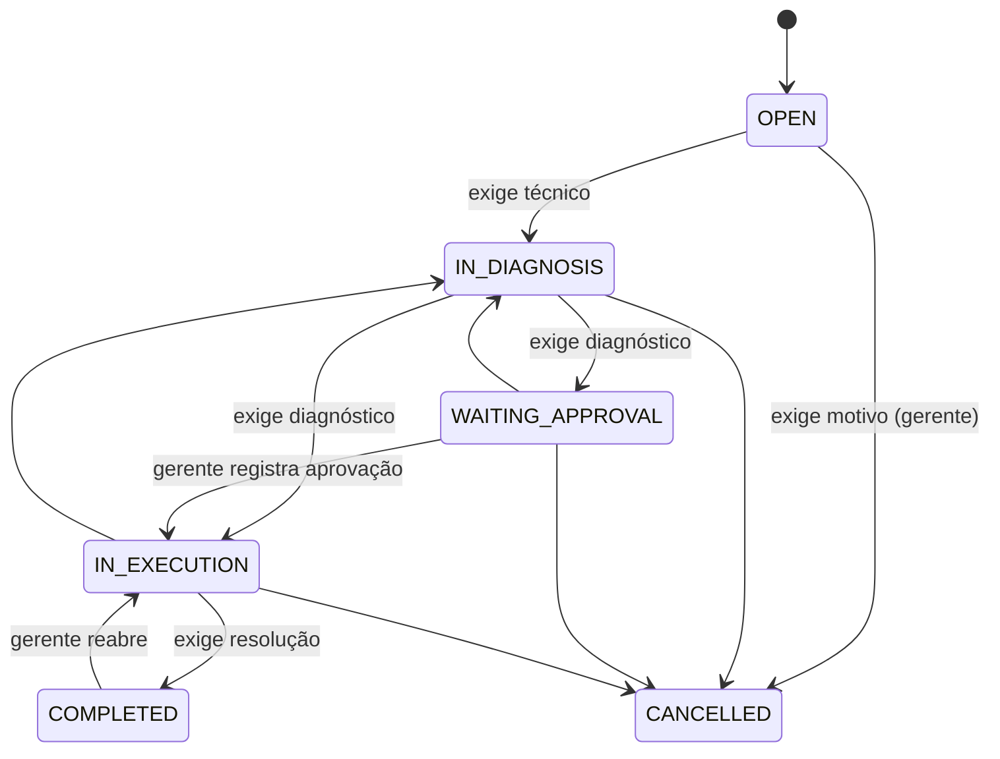

# FlowDesk

[](https://github.com/SEU_USUARIO/flowdesk/actions/workflows/ci.yml)


**Plataforma multiempresa de atendimento e ordens de serviço** para empresas de manutenção, assistência técnica, informática e serviços especializados.
Cada empresa cadastra sua equipe, abre ordens de serviço e as conduz por um **fluxo de trabalho com transições válidas**, com **trilha de auditoria**, **alertas de SLA**, **notificações assíncronas** e **relatórios de produtividade**.

> 🇺🇸 English version: [README.md](README.md)

## Por que este projeto

Foi pensado para demonstrar engenharia de backend do mundo real, e não apenas CRUD:

| Tema | Como o FlowDesk resolve |
|---|---|
| **Regras de negócio** | Máquina de estados explícita; saltos inválidos (ex.: `OPEN → COMPLETED`) são recusados e cada etapa exige seus dados |
| **Multiempresa** | Schema compartilhado com `company_id`; a empresa vem sempre do usuário autenticado e ids de outra empresa respondem `404` |
| **Segurança** | JWT stateless, BCrypt, perfis (Admin / Gerente / Técnico), usuário revalidado no banco a cada requisição |
| **Auditoria** | Log append-only gravado na mesma transação de cada alteração |
| **Assíncrono** | Eventos de domínio → listeners `@Async` + `AFTER_COMMIT` para notificações no sistema e e-mail |
| **Confiabilidade** | Lock otimista, numeração sequencial por empresa com lock de linha, monitor de SLA idempotente |
| **Qualidade** | Testes unitários do workflow + testes ponta a ponta com PostgreSQL real (Testcontainers), JaCoCo, CI |
| **Operação** | Migrations Flyway, imagem Docker, Docker Compose, health probes, OpenAPI/Swagger |

## O fluxo de trabalho



Todas as regras ficam em uma única classe sem dependência de framework ([`ServiceOrderWorkflow`](src/main/java/com/flowdesk/serviceorder/ServiceOrderWorkflow.java)) e geram o status HTTP correto:

| Situação | Status |
|---|---|
| Transição não permitida pela máquina de estados | `409 Conflict` |
| Perfil/posse não permite a ação | `403 Forbidden` |
| Dados faltando (diagnóstico, resolução, motivo, técnico) | `422 Unprocessable Entity` |
| Ordem de outra empresa | `404 Not Found` |

## Perfis de acesso

| Capacidade | Técnico | Gerente | Admin |
|---|:--:|:--:|:--:|
| Ver ordens | só as atribuídas a ele | todas | todas |
| Criar / editar / atribuir ordens | – | ✅ | ✅ |
| Mudar status | só as próprias (sem cancelar, aprovar ou reabrir) | ✅ | ✅ |
| Registros de atendimento e anexos | nas próprias | ✅ | ✅ |
| Gerenciar clientes | – | ✅ | ✅ |
| Painel e relatórios | – | ✅ | ✅ |
| Criar usuários, ativar/desativar | – | – | ✅ |

## Funcionalidades

- Empresas (tenants), usuários com perfis, clientes
- Ordens com prioridade (Baixa → Urgente), responsável e numeração `OS-000123` por empresa
- Prazo (SLA) calculado pela prioridade (configurável) e recalculado quando a prioridade muda
- **Registros de atendimento** do técnico (anotações e minutos gastos)
- **Anexos** com tipos permitidos, limite de tamanho e nomes de arquivo sanitizados
- **Linha do tempo de auditoria** por ordem (quem mudou o quê, de qual valor para qual)
- **Notificações** no sistema e por e-mail (gateway plugável), alertas de SLA "vencendo" e "estourado"
- **Painel**: ordens por status/prioridade, atrasadas, concluídas, taxa no prazo, tempo médio de resolução
- **Relatório de produtividade** por técnico e **exportação CSV**
- Filtros, busca e paginação, erros no padrão RFC 7807, documentação OpenAPI

## Tecnologias

Java 21 · Spring Boot 3.3 · Spring Web, Data JPA (Hibernate), Security, Validation, Actuator · PostgreSQL 16 · Flyway · JWT (jjwt) · springdoc-openapi · JUnit 5, MockMvc, Testcontainers · JaCoCo · Docker / Docker Compose · GitHub Actions

## Como rodar

### Opção 1 — Docker Compose (recomendada)

```bash
cp .env.example .env
# opcional: defina SPRING_PROFILES_ACTIVE=demo no .env para carregar dados de exemplo
docker compose up --build
```

- API: http://localhost:8080
- Swagger UI: http://localhost:8080/swagger-ui.html
- Health: http://localhost:8080/actuator/health

Com o perfil `demo` você já entra direto (senha `Demo@12345`):

| Usuário | Perfil |
|---|---|
| `admin@demo.flowdesk.dev` | Admin |
| `manager@demo.flowdesk.dev` | Gerente |
| `bruno@demo.flowdesk.dev`, `carla@demo.flowdesk.dev` | Técnicos |

### Opção 2 — Local

Requisitos: JDK 21, Maven 3.9+, PostgreSQL 16 (ou `docker compose up db`).

```bash
mvn spring-boot:run -Dspring-boot.run.profiles=demo
```

### Testes

```bash
mvn verify          # unitários + integração (precisa de Docker para o Testcontainers) + cobertura
```

Relatório de cobertura: `target/site/jacoco/index.html`.

## Tour pela API

Requisições prontas em [`docs/api.http`](docs/api.http). Exemplo — um salto inválido é recusado:

```http
POST /api/service-orders/{id}/transitions
{ "targetStatus": "COMPLETED", "resolution": "Feito" }

409 Conflict
{ "title": "Invalid workflow transition",
  "detail": "Cannot move a service order from OPEN to COMPLETED. Allowed targets: [IN_DIAGNOSIS, CANCELLED]" }
```

A lista completa de endpoints está no [README em inglês](README.md#api-tour) e no Swagger UI.

## Arquitetura e decisões

Monólito modular organizado por funcionalidade (package-by-feature). As decisões importantes estão registradas como ADRs em [`docs/adr`](docs/adr):

1. [Máquina de estados explícita](docs/adr/0001-explicit-workflow-state-machine.md)
2. [Multiempresa com schema compartilhado](docs/adr/0002-multi-tenancy-shared-schema.md)
3. [Trilha de auditoria append-only](docs/adr/0003-audit-trail.md)
4. [Notificações assíncronas e monitor de SLA idempotente](docs/adr/0004-async-notifications-and-sla.md)
5. [Lock otimista e numeração por empresa](docs/adr/0005-optimistic-locking-and-order-numbers.md)

## Configuração

| Variável | Finalidade | Padrão |
|---|---|---|
| `DB_URL`, `DB_USER`, `DB_PASSWORD` | Conexão PostgreSQL | Postgres local |
| `JWT_SECRET` | Chave HMAC, **≥ 32 bytes** (obrigatória em produção) | valor só para dev |
| `JWT_EXPIRATION_MINUTES` | Validade do token | `60` |
| `STORAGE_PATH` | Pasta dos anexos | `./data/attachments` |
| `CORS_ALLOWED_ORIGINS` | Origens do front-end | `localhost:3000,5173` |
| `SPRING_PROFILES_ACTIVE` | `demo` carrega dados de exemplo | – |

## Próximos passos

- Front-end React + TypeScript (Kanban por status, detalhe da ordem com timeline)
- Outbox transacional + broker de mensagens para entrega garantida de notificações
- Armazenamento de objetos (compatível com S3) atrás da interface `FileStorage`
- Refresh tokens e rate limiting no login
- Row Level Security do PostgreSQL como segunda camada de isolamento
- Fluxos e políticas de SLA configuráveis por empresa

## Licença

[MIT](LICENSE)
